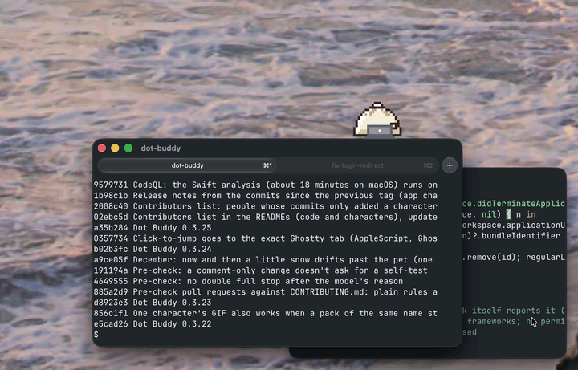
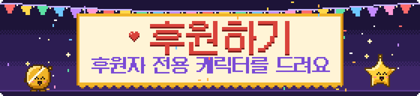

<p align="center">
  
</p>

<h1 align="center">도트 친구 (Dot Buddy)</h1>

<p align="center"><a href="README.md">English</a> | 한국어</p>

<!-- 맨 위 GIF 는 실제 화면 녹화, 나머지는 앱이 직접 그려요(README.md 맨 위 주석 참고) -->
<p align="center">
  
</p>

**코딩 에이전트가 일하는지, 끝났는지, 나를 기다리는지 알려 주는 macOS 바탕화면 도트 펫이에요.**

도트 친구는 바탕화면에 살면서 창 윗변과 위젯 위를 걸어 다니고, Claude Code 세션을 지켜봐요(다른 에이전트도 붙일 수 있어요). 세션이 끝나거나 질문을 하면 말풍선으로 알려 주고, 말풍선을 누르면 그 터미널 탭으로 가요.

- Swift 로 만든 맥 앱이고 외부 라이브러리가 하나도 없어요. 소스로 1분쯤이면 빌드돼요
- 세션 파일만 읽어요. 에이전트의 훅이나 설정은 건드리지 않아요
- 네트워크에 접속하지 않아요(켜 둔 경우의 6시간마다 업데이트 확인만 빼고)
- 화면 글은 한국어와 영어 두 가지예요

<p align="center"><a href="https://github.com/sponsors/doldoldol21"></a></p>

## 무엇에 반응하나요

<p align="center">
  
</p>

펫 한 마리가 모든 세션 중 가장 급한 상태를 보여 줘요.

| 상태 | 언제 | 보이는 모습 |
|---|---|---|
| 질문 | 세션이 내 답을 기다릴 때 | `?` 말풍선, 손을 흔들어요. 45초 동안 답이 없으면 커서 옆으로 찾아와 불러요(다른 모니터여도요, 최대 3번) |
| 끝남 | 세션이 끝났는데 아직 안 봤을 때 | 세션 이름과 "끝났어요!" 말풍선, 개수가 적힌 ✓ 배지 |
| 일하는 중 | 세션이 하나라도 일하고 있을 때 | 노트북을 두드려요. 파일 읽기·고치기·시험·커밋에 작게 반응해요 |
| 여러 세션 | 세션 여러 개가 동시에 돌 때 | 응원해 줘요(오늘 최고 기록도 기억해요) |
| 쉼 | 아무 일도 없을 때 | 돌아다니고, 가장자리에 걸터앉고, 잠들어요 |

펫을 누르면 다 봤다는 표시가 돼요. 끝난 세션은 5분 동안만 알려 주고 그 뒤로는 조르지 않아요.

## 기능

- **바탕화면에 살아요.** 화면 아래, 바탕화면 위젯, 창 윗변을 걸어 다녀요. 창 뒤에 숨었다가 창이 덮으면 보이는 데로 걸어 나와요. 모니터 사이도 오가요.
- **오르고, 매달리고, 떨어져요.** 창 옆면을 오르고, 모서리에 매달리고, 가장자리에 앉고, 가끔 마우스 커서를 덮쳐요.
- **끌어서 던질 수 있어요.** 집어 던지면 부딪힌 창이나 위젯 위에 내려앉아요. 투명한 부분은 클릭이 그대로 통과해요.
- **누르면 그 세션으로 가요.** 말풍선을 누르면 그 세션의 터미널로 가요.

  | 터미널 | 가는 곳 |
  |---|---|
  | [cmux](https://github.com/manaflow-ai/cmux) | 그 탭까지(cmux CLI) |
  | 터미널(Terminal) | 그 탭까지(AppleScript, 처음 한 번 자동화 권한을 물어요) |
  | iTerm2 | 그 세션까지(AppleScript, 처음 한 번 자동화 권한을 물어요) |
  | [Ghostty](https://ghostty.org) 1.4 이상 | 그 탭·분할 창까지(AppleScript, 처음 한 번 자동화 권한을 물어요) |
  | [WezTerm](https://wezterm.org) | 그 탭·분할 창까지(wezterm CLI) |
  | 위 터미널 안의 tmux | tmux 창·pane 까지 고르고, 그 터미널 탭으로 가요. 그 tmux 세션을 보는 터미널이 없으면 마지막에 쓴 터미널을 그 세션으로 바꿔요 |
  | 그 밖(kitty, VS Code 등) | 그 앱을 앞으로 가져와요 |

  에이전트마다 내 명령으로 바꿀 수도 있어요([설정](#설정) 참고).
- **캐릭터.** 오리지널 도트 캐릭터 여섯(만두, 도토리, 새싹 화분, 구름, 촛불, 이끼돌)이 있고, 캐릭터마다 혼잣말과 효과가 달라요. 직접 그려 넣을 수도 있고, 남이 보내 준 캐릭터(zip, 폴더, PNG)는 펫 위에 끌어 놓으면 바로 깔려요. [CHARACTERS.ko.md](CHARACTERS.ko.md)를 보세요.
- **커뮤니티 캐릭터.** 다른 사람이 그린 캐릭터를 메뉴(캐릭터 → **다른 캐릭터 받기…**)에서 바로 받고, [갤러리](https://dot-buddy.github.io/characters/ko/)에서 둘러볼 수도 있어요. 내 캐릭터는 [dot-buddy/characters](https://github.com/dot-buddy/characters/blob/main/README.ko.md)에 풀 리퀘스트로 올려요.
- **Codex 펫.** Codex 앱용 펫(`pet.json` + 8×9 스프라이트 시트)을 `~/.codex/pets/` 에서 그대로 불러와요. 내려받은 Codex 펫 zip 은 풀지 말고 그대로 펫 위에 끌어 놓으면 돼요.
- **GIF로 공유.** 캐릭터 → **이 캐릭터 GIF로 저장**을 누르면 지금 캐릭터가 움직이는 짧은 GIF가 다운로드 폴더에 생겨요. 그대로 올리면 돼요.
- **악세사리.** 특별한 날에만 이스터에그처럼 꾸며요. 오픈 기념 파티 모자(2027년 2월 25일까지), 12월의 산타 모자와 눈, 크리스마스와 새해 첫날 인사가 있어요. 메뉴의 **악세사리 끄기**로 끌 수 있어요.
- **원하면 소리도.** 기본은 꺼져 있어요. 메뉴의 **끝나면 소리 내기**를 켜면 세션이 끝나거나 질문할 때 짧은 시스템 소리가 나요.
- **오늘 끝낸 일.** 메뉴 맨 위에 오늘 끝난 일이 몇 개인지 보여 줘요.
- **두 언어.** 시스템 언어를 따르고, 메뉴에서 한국어와 영어를 바꿀 수 있어요.

## 설치

macOS 13 이상이 필요해요.

### 한 줄 설치(추천)

```bash
curl -fsSL https://raw.githubusercontent.com/doldoldol21/dot-buddy/main/install.sh | bash
```

최신 릴리스를 받아 서명을 확인하고 `~/Applications` 에 넣어요. 브라우저로 받은 게 아니라서 macOS 가 '그래도 열기' 없이 바로 열어요. 다시 돌리면 업데이트되고, `DOTBUDDY_CLI=1` 을 붙이면 명령줄 도구도 깔아요. 짧은 스크립트라 [install.sh](install.sh) 를 먼저 읽어 봐도 돼요.

### 소스로 빌드하기

Xcode 명령줄 도구(`xcode-select --install`)만 있으면 돼요.

```bash
git clone https://github.com/doldoldol21/dot-buddy.git
cd dot-buddy
./build.sh                 # 이 맥에 맞게 빌드해서 ~/Applications/Dot Buddy.app 에 설치
open ~/Applications/"Dot Buddy.app"
```

- `./build.sh --universal` 은 Apple 실리콘과 Intel 맥에서 다 도는 앱을 만들어요.
- `APP=/경로/Dot\ Buddy.app ./build.sh` 로 다른 곳에 설치하고, `FORCE=1` 이면 바뀐 게 없어도 다시 빌드해요.
- 빌드할 때 도트 글꼴 두 가지(갈무리, Neo둥근모, SIL OFL 1.1)를 받아서 체크섬을 확인해요. 인터넷이 안 되면 시스템 글꼴로 빌드돼요.
- `python3` 가 있으면 고화질 기본 캐릭터도 그려 넣어요. 없으면 코드로 그린 작은 그림으로 나와요.

### Homebrew

```bash
brew install --cask doldoldol21/tap/dot-buddy
```

같은 릴리스 zip(공증 안 됨)이라 처음 열 때는 아래 '그래도 열기' 절차가 필요해요. 그 뒤로는 앱이 스스로 업데이트해요(`brew upgrade --greedy` 도 돼요).

### 릴리스 받기

[릴리스](https://github.com/doldoldol21/dot-buddy/releases)마다 유니버설 `Dot-Buddy-<버전>.zip` 이 있어요. 압축을 풀고 `Dot Buddy.app` 을 `~/Applications` 나 `/Applications` 로 옮기세요.

릴리스 빌드는 임시(ad-hoc) 서명만 했고 **공증을 받지 않아서**, 처음 열 때 macOS 가 막아요.

1. 앱을 한 번 열어요. 확인할 수 없다는 창이 뜨면 **완료**를 눌러요.
2. **시스템 설정 → 개인정보 보호 및 보안**을 열고 **보안** 항목까지 내려가서 "Dot Buddy" 옆의 **그래도 열기**를 눌러요. 이 버튼은 앱을 열어 본 뒤 한 시간쯤만 보여요.
3. 로그인 암호로 확인해요.

macOS 14 이하에서는 앱을 Control-클릭하고 **열기**를 고르면 돼요. Gatekeeper 를 우회하고 싶지 않다면 소스로 빌드하세요. 직접 빌드한 앱은 격리 표시가 붙지 않아요.

## 업데이트

릴리스로 받은 앱은 스스로 업데이트해요. 오른쪽 클릭 메뉴의 **자동으로 업데이트**를 켜면(처음 켤 때도 물어봐요) 6시간마다 GitHub 를 보고, 새 업데이트가 있으면 받아서 Ed25519 서명과 앱 묶음을 확인한 뒤 에이전트가 일하지 않을 때 바꿔 끼우고 다시 켜요(세 시간을 기다려도 계속 바쁘면 그냥 바꿔요). **업데이트 확인…** 은 바로 확인하고, 새 버전이 있으면 바로 깔아요. 이전 버전은 휴지통으로 가요.

소스로 빌드한 앱은 스스로 바뀌지 않고 새 업데이트가 나왔다고만 알려 줘요(`git pull && ./build.sh`).

## 지우기

1. 펫을 오른쪽 클릭해 **로그인할 때 켜기**를 끄고 **종료**해요.
2. 앱을 지워요. Homebrew 로 깔았으면 `brew uninstall --cask dot-buddy`(`--zap` 을 붙이면 3번 파일까지 지워요), 아니면 `~/Applications`(또는 `/Applications`)의 `Dot Buddy.app` 을 휴지통으로 옮겨요.
3. 남은 것(내 캐릭터, 세션 상태, 설정)을 지워요.

```sh
rm -rf ~/Library/Application\ Support/DotBuddy
defaults delete io.github.doldoldol21.dot-buddy
rm -f ~/.local/bin/dotbuddy ~/.local/bin/dotbuddy-hook   # 명령줄 도구를 깔았을 때만
```

도트 친구는 Claude Code 설정이나 훅을 건드리지 않아서 거기서 되돌릴 건 없어요. 다른 에이전트를 연결했다면 그 설정에 넣은 `dotbuddy-hook` 줄을 지워요.

## 빠르게 시작하기

1. 도트 친구를 켜요. 펫이 바탕화면에 떨어져요.
2. 아무 터미널에서 Claude Code 세션을 열고 일을 시켜요. 펫이 노트북을 꺼내요.
3. 일이 끝나면 말풍선이 떠요. 누르면 그 탭으로 돌아가요.
4. 펫을 오른쪽 클릭하면 설정이 나와요.

처음 켜면 펫이 말풍선 몇 개로 자기를 소개하고, 로그인할 때 켤지 물어봐요. 나중에 오른쪽 클릭 메뉴에서 바꿀 수 있어요.

## 어떻게 동작하나요

훅을 설치하지 않고 Claude Code 가 남기는 세션 파일을 읽어요.

- `~/.claude/sessions/*.json` 에서 세션마다 상태(`busy`·`idle`), 이름, 프로세스 번호를 봐요. `CLAUDE_CONFIG_DIR` 을 바꿨으면 그쪽을 봐요.
- 프로세스가 끝난 세션은 빠져요. 20분 넘게 쉰 세션은 쉬는 걸로 쳐요.
- 질문 대기를 알아채려고 그 세션 기록의 끝 64KB 만 읽어서 답을 안 받은 `AskUserQuestion` 이 있는지 봐요.
- 세션이 일하는 동안은 기록에 새로 붙는 줄만 따라 읽어서 도구 사용(읽기·고치기·시험·커밋·서브에이전트·에러)에 반응해요. 지난 기록은 읽지 않아요. 수다를 끄면 이것도 멈춰요.

다른 에이전트는 앱에 든 CLI 로 상태를 알려요([다른 에이전트](#다른-에이전트) 참고).

### 개인정보

- **읽기만 해요.** `~/.claude` 에 아무것도 쓰지 않고, 훅·설정·`CLAUDE.md`·MCP 설정을 고치지 않고, 에이전트 컨텍스트에 아무것도 넣지 않아요.
- **업데이트를 켤 때만 네트워크를 써요.** 처음 켤 때 업데이트 확인을 할지 물어봐요. 켜면 6시간마다 github.com 에서 이 레포의 최신 릴리스만 보고, 보내는 건 앱 버전(User-Agent)뿐이에요. 끄면 어디에도 접속하지 않아요. 단 **다른 캐릭터 받기…** 를 열면 [dot-buddy/characters](https://github.com/dot-buddy/characters) 의 커뮤니티 목록을 읽어요. 글꼴은 `build.sh` 가 빌드할 때 받아요.
- **화면에 나오는 것.** 말풍선에는 세션 이름과 터미널 탭 제목이 나와요. 파일 경로, 명령, 내 질문은 나오지 않아요. 화면을 공유하면 이 이름들이 보이니까, 발표 전에는 수다를 끄거나 앱을 꺼 두세요.
- 앱이 쓰는 파일은 `~/Library/Application Support/DotBuddy/` 에만 있어요(캐릭터, `tools.json`, `--report` 가 남기는 상태 파일).

## 다른 에이전트

Claude Code 는 따로 할 게 없어요. 다른 에이전트는 먼저 오른쪽 클릭 메뉴의 **명령줄 도구 설치**를 눌러요(또는 `"$HOME/Applications/Dot Buddy.app/Contents/MacOS/DotBuddy" --install-cli`). `~/.local/bin` 에 명령 두 개가 링크로 깔리고, 앱이 스스로 업데이트해도 그대로 써요.

- `dotbuddy`: 앱의 CLI 예요. 아래에서 써요.
- `dotbuddy-hook 도구 ID_키 동작 [응답]`: 훅이 JSON 을 표준 입력으로 주는 에이전트용이에요. JSON 의 `ID_키` 에서 세션 id 를 읽어 `동작`(`busy`·`idle`·`ask`·`end`·`event:이름`)을 알리고, 에이전트가 응답을 기다리면 `응답`을 찍고, 늘 0 으로 끝나요.

그다음 그 에이전트의 훅에서 불러요.

```bash
DOTBUDDY=dotbuddy   # 또는 앱 안의 전체 경로

"$DOTBUDDY" --report <도구> <세션-id> busy|idle|ask|end [--name 이름] [--label 부를 이름] [--pid PID]
"$DOTBUDDY" --signal event read|edit|test|commit|shell|web|skill|error|bg-start|bg-done|agent-start[:이름]|agent-done
"$DOTBUDDY" --run [--tool 이름] -- <명령 …>   # 아무 CLI 나 감싸기: 도는 동안 일하는 중, 끝나면 끝남
```

Codex CLI, Gemini CLI, Cursor, opencode, Aider 설정은 [docs/agents.md](docs/agents.md)에 복사해서 쓸 수 있게 정리해 뒀어요(영어).

## 내 캐릭터 넣기

<p align="center"></p>

다른 사람이 그린 캐릭터는 오른쪽 클릭 → 캐릭터 → **다른 캐릭터 받기…** 에서 받아요([갤러리](https://dot-buddy.github.io/characters/ko/), 받은 zip 은 펫에 끌어다 놓아도 돼요).

직접 만들려면 `~/Library/Application Support/DotBuddy/charas/` 에 PNG 를 넣고(오른쪽 클릭 → 캐릭터 → 캐릭터 폴더 열기) **캐릭터 다시 불러오기**를 누르면 돼요. 그림 한 장이면 충분하고, 움직임은 앱이 만들어요. 동작마다 직접 그려 넣을 수도 있어요. 여기에 넣은 Codex 펫도 불러와요.

동작 이름 전체와 `chara.json` 형식은 [CHARACTERS.ko.md](CHARACTERS.ko.md)에 있어요.

## 설정

**설정 메뉴**(펫을 오른쪽 클릭): 오늘 끝낸 일(그날 처음 끝났을 때부터), 세션(각자 뭘 하는지, 고르면 그 터미널로), 잠깐 숨기기, 캐릭터, 크기, 돌아다니기(창으로 놀러 가는 빈도), 수다(수다쟁이부터 끄기까지), 말풍선 글꼴, 말풍선 글자 크기(캐릭터 크기와 따로), 언어, 악세사리 끄기, 끝나면 소리 내기(기본은 끔), 업데이트 확인…, 자동으로 업데이트, 명령줄 도구 설치, 로그인할 때 켜기, 종료. 세션 세 개 이상이 한꺼번에 끝나면 말풍선 하나로 묶어 보여 줘요("4곳 끝남: api, web, docs…").

**`tools.json`**(`~/Library/Application Support/DotBuddy/tools.json`)으로 에이전트마다 꾸밀 수 있어요. 고치면 다음에 읽을 때 바로 반영되고 앱을 다시 켤 필요가 없어요. 키는 `--report` 에 준 도구 이름이에요(Claude Code 는 `claude`). `*` 는 모든 도구에 적용돼요.

```json
{
  "codex": {
    "label": "코덱스",
    "fill": "#eef4ff", "askFill": "#fff0d8", "edge": "#3a4a6a", "titleColor": "#24304a",
    "done": ["코덱스 끝!"],
    "ask": ["코덱스가 물어봐요"],
    "praise": ["코덱스 {n}개 출동!"],
    "showLabel": true
  },
  "cursor": { "open": ["open", "-a", "Cursor"] }
}
```

| 키 | 뜻 |
|---|---|
| `label` | 펫이 이 에이전트를 부르는 이름 |
| `fill`, `askFill`, `edge`, `titleColor` | 말풍선 색(`#rrggbb`) |
| `done`, `ask` | 끝남·질문 말풍선의 끝줄(그중 하나를 골라요) |
| `praise` | 여러 세션을 돌릴 때 하는 칭찬. `{n}` 은 세션 수 |
| `showLabel` | 말풍선 제목 앞에 이름을 붙여요 |
| `open` | 이 에이전트의 말풍선을 누르면 돌릴 명령(인자 배열). 자리표시 `{pid}`, `{tty}`, `{id}`, `{tool}`, `{name}`, `{app}` 를 바꿔 넣어요. 실패하면 기본 동작으로 가요 |

`open` 명령은 셸 없이 내 권한으로 돌아요. `--signal` 로 뜬 말풍선은 이 명령을 돌리지 않아요.

## 문제 해결

| 증상 | 해 볼 것 |
|---|---|
| Claude Code 세션에 반응하지 않아요 | `"$DOTBUDDY" --state` 를 돌려 보세요. `sessions` 가 비어 있으면 Claude Code 가 도는 동안 `~/.claude/sessions/` 에 `.json` 파일이 있는지 보세요. 최근 버전의 Claude Code 가 필요해요. |
| 터미널, iTerm2, Ghostty 에서 말풍선을 눌러도 탭이 안 바뀌어요 | **시스템 설정 → 개인정보 보호 및 보안 → 자동화**에서 도트 친구를 허용하세요. |
| 말풍선을 눌러도 아무 일이 없어요 | 그 세션이 일반 터미널 앱에서 돌지 않는 경우예요(예: IDE 안의 에이전트). `tools.json` 에 `open` 명령을 넣으세요. |
| 말풍선 글자가 시스템 글꼴이거나 네모로 나와요 | 빌드 때 글꼴을 못 받았어요. 인터넷이 되는 곳에서 다시 빌드하세요. |
| 캐릭터가 작고 단순해요 | 빌드 때 `python3` 를 못 찾았어요. 설치하고 다시 빌드하세요. |
| 내 캐릭터가 안 보여요 | `"$DOTBUDDY" --charas` 로 불러온 목록을 보고, 칸 크기를 [CHARACTERS.ko.md](CHARACTERS.ko.md)와 맞춰 보세요. |
| "Dot Buddy 을(를) 열 수 없습니다" | [릴리스 받기](#릴리스-받기)의 Gatekeeper 순서를 따라 하거나, 이 확인이 뜨지 않는 [한 줄 설치](#한-줄-설치추천)로 깔아요. |
| 지우고 싶어요 | 메뉴에서 종료하고, 앱과 `~/Library/Application Support/DotBuddy/` 를 지우세요. 설정은 `defaults` 의 `io.github.doldoldol21.dot-buddy` 에 있어요. |

## 기여하기

버그 제보, 직접 그린 캐릭터, 다른 에이전트 연동 모두 반가워요. 도트 친구는 보고 즐기는 펫이라서 채팅, AI 호출, 에이전트에 입력을 보내는 기능은 받지 않아요. 기능을 만들기 전에 [CONTRIBUTING.md](CONTRIBUTING.md#what-dot-buddy-is-for)를 보세요(영어). 보안 문제는 [SECURITY.md](SECURITY.md)대로 비공개로 알려 주세요.

함께 만들어 주신 분들, 고마워요.

<!-- contributors:start -->
<p><b>코드</b></p>
<table><tr><td align="center"><a href="https://github.com/doldoldol21"><br><sub>doldoldol21</sub></a></td></tr></table>

<p><b>캐릭터</b></p>
<table><tr><td align="center"><a href="https://github.com/doldoldol21"><br><sub>doldoldol21</sub></a></td><td align="center"><a href="https://github.com/GaneshUbale"><br><sub>GaneshUbale</sub></a></td></tr></table>
<!-- contributors:end -->

## 후원

도트 친구가 쓸 만했다면 [GitHub 에서 후원](https://github.com/sponsors/doldoldol21)해 주세요(펫을 오른쪽 클릭 → **도트 친구 후원하기…**). 월 후원자분께는 후원자 전용 캐릭터를 드려요.

## 라이선스와 감사

MIT 라이선스예요([LICENSE](LICENSE)). 함께 들어가는 글꼴은 SIL Open Font License 1.1 이고, 자세한 내용은 [THIRD_PARTY_NOTICES.md](THIRD_PARTY_NOTICES.md)에 있어요.

갈라져 나간 판(포크)도 MIT 라이선스대로 환영해요. 공개할 때는 저작권 표시를 남기고, 도트 친구로 오해받지 않게 이름과 아이콘을 다르게 해 주세요.

- [OpenPets](https://github.com/alterhq/openpets)(MIT)에서 몇 가지 동작을 참고했어요. 투명한 부분 클릭 통과, 움직일 때만 빠르게 그리기, 던지기 속도 재는 방법이에요. 코드는 가져오지 않았어요.
- Codex 펫 형식(`pet.json` + 8×9 스프라이트 시트)은 호환을 위해 읽기만 해요. 도트 친구는 OpenAI, Anthropic 과 관계가 없어요.
- 말풍선 글꼴: [갈무리](https://github.com/quiple/galmuri), [Neo둥근모](https://github.com/neodgm/neodgm).
